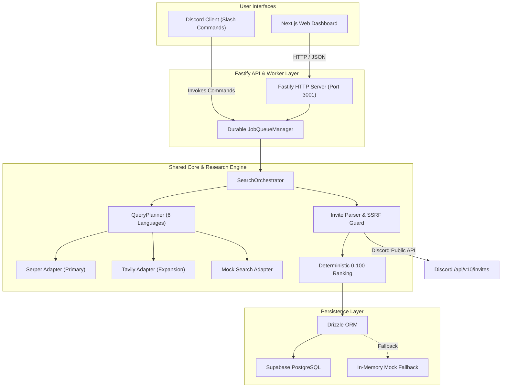

# System Architecture & Data Flow

This document details the architectural decisions, pipeline workflows, and separation of concerns for Discord Link Hunter v2.1.

## High-Level Architecture Diagram

## Data Flow Pipeline

1. **Input Validation**:
   - The user requests a search via Discord (`/hunt topic:forex language:en limit:10`) or via Web Dashboard.
   - Parameters are validated using strict Zod schemas against allowed trading sectors and language codes.
2. **Query Planning**:
   - `QueryPlanner` looks up native synonyms from `LANGUAGE_TRADING_DICTIONARIES` for each requested language.
   - Pairs terms with Discord invite patterns (`"discord.gg/"`, `"discord.com/invite/"`).
   - Caps total planned queries to `SEARCH_MAX_QUERIES_PER_JOB` (default 12) to prevent combinatorial explosion.
3. **Multi-Provider Search**:
   - In `live` mode: Serper executes primary Google-indexed discovery with a concurrency limit of 2.
   - If Serper encounters rate limits or errors, Tavily acts as an automatic fallback.
   - For `depth: 2`, Tavily performs targeted secondary expansion.
   - In `mock` mode: `MockSearchAdapter` yields realistic multilingual mock fixtures without consuming external quotas.
4. **URL Extraction & SSRF Defense**:
   - `extractDiscordInvites` searches titles, snippets, and URLs for Discord invite codes.
   - Canonicalizes codes into `https://discord.gg/{code}`.
   - `isSafeUrl` guards against SSRF by blocking localhost, private ranges (`10.0.0.0/8`, `172.16.0.0/12`, `192.168.0.0/16`), link-local/cloud metadata (`169.254.169.254`), and non-HTTP schemes.
5. **Discord Verification**:
   - Calls `https://discord.com/api/v10/invites/{code}?with_counts=true&with_expiration=true`.
   - Classifies status: `valid`, `expired_or_revoked`, `rate_limited`, `unavailable`, `unknown`.
   - Crucially: **network timeouts or 5xx errors are NEVER marked as invalid**.
6. **Scoring & Ranking**:
   - `calculateInviteScore` evaluates 6 objective criteria (0–100 total):
     - Topic relevance (35)
     - Invite validity (20)
     - Language match (15)
     - Source credibility (10)
     - Freshness (10)
     - Verified size/presence (10)
   - Results are sorted descending by score and persisted.
7. **Storage & Presentation**:
   - Persisted to Supabase PostgreSQL or In-Memory repository.
   - Rendered in Discord embeds and the Web Dashboard.

